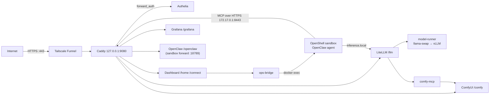

# GB10 Agent Stack: design

How the pieces fit together and why. To run it, see [`README.md`](README.md); for every setting, [`VARIABLES.md`](VARIABLES.md).

## 1. Architecture

| Service | Role |
|---|---|
| `caddy` (host network) | Only entry point (`127.0.0.1:9080`, published by Funnel). Path routing and `forward_auth` to Authelia. A second listener `https://172.17.0.1:8443` serves only `/llm/*/mcp` to the sandbox |
| `authelia` | Login portal, password + TOTP/passkey on every UI path. Users in `authelia/users.yml` |
| `litellm` + `litellm-db` | OpenAI-compatible gateway at `/llm/v1`: virtual keys, rate limits, budgets, usage; MCP gateway; Prometheus + OTel |
| `model-runner` | llama-swap running one vLLM model (`qwen3.6-35b`, alias `agent`), kept loaded (`ttl: 0` + startup preload) |
| `comfyui`, `comfy-mcp` | FLUX schnell fp8; `comfy-mcp` exposes `generate_image` / `list_checkpoints` and returns a link, never image bytes |
| `admin-dashboard` | Model/ComfyUI controls, service status, OpenClaw device approval, `/connect` |
| `ops-bridge` | Allow-listed commands in other containers (`ops-bridge/actions.yaml`); the dashboard's only route into the sandbox |
| `docker-socket-proxy` | Read-only Docker API (`CONTAINERS`, `INFO`, `NETWORKS`, `POST=0`) for the dashboard and Alloy |
| `alloy`, `prometheus`, `loki`, `tempo`, `grafana`, `node-exporter`, `cadvisor`, `gpu-exporter` | Observability |
| NemoClaw (host CLI) | Creates and manages the OpenShell gateway and the sandbox `nemoclaw-assistant` (not compose services) |

Networks: `ai` (apps) and `obs` (telemetry) are internal; compose publishes only to `127.0.0.1` and `${DOCKER_BRIDGE_IP}` (LiteLLM `:4000`, Alloy `:4318` for the sandbox).

## 2. Routing

| Path | Upstream | Who |
|---|---|---|
| `/auth*` | Authelia | anyone |
| `/llm/v1/*` | LiteLLM | bearer key (Authelia bypassed; `Remote-*` headers stripped) |
| `/llm*` (UI, MCP) | LiteLLM (the UI has its own login) | admins, users |
| `/openclaw*` | sandbox forward `127.0.0.1:18789` (WebSocket) | admins, users |
| `/connect` | dashboard | admins, users |
| `/home/*` (landing page) | dashboard | admins, users (the page and its actions are filtered, see §6) |
| `/grafana*` | Grafana (auth-proxy header) | admins, users |
| `/comfy/*` | ComfyUI | admins |
| anything else, and the old `/admin` | redirect to `/home/` | |

Access rules live in `authelia/configuration.yml` (`default_policy: deny`, `two_factor`; session 12 h / 1 h idle; 3 failed logins = 30 min ban). Caddy forces `X-Forwarded-Proto: https` toward Authelia because Funnel traffic arrives as plain HTTP.

## 3. Authentication

| Client | Mechanism |
|---|---|
| Browser | Authelia session (password + TOTP or passkey) checked by Caddy on every UI path |
| Grafana | Authelia identity headers → Grafana auth-proxy (trusted only from Docker ranges). New accounts are `Viewer`; promote admins in Grafana |
| API clients | LiteLLM virtual key: `laptop` (any model, 30 rpm, $50 / 30 d), `scripts` (`agent`, 10 rpm), `openclaw-sandbox` (60 rpm, the only key with MCP access) |
| Sandbox → LiteLLM | `openclaw-sandbox` key held in the OpenShell credential store; never inside the sandbox |
| Dashboard → ops-bridge | Bearer token in `secrets/bridge_dashboard_token` |

**OpenClaw access.** NemoClaw rewrites `gateway.auth.token` at every sandbox start and OpenClaw refuses `trusted-proxy` while a token is set, so Authelia cannot sign you in directly. Instead: Authelia gates the URL; `/connect` (admins and users) reads the shared gateway token through ops-bridge and redirects to `/openclaw/#token=…` (no-store, no referrer, never logged); each browser must also be a paired device, approved in the dashboard. Per-person control is therefore the Authelia group, the device list and **Revoke** (which invalidates the token and removes the entry). The *Open for N min* enrollment window auto-approves new Control-UI pairings only (never scope upgrades or the CLI) and labels the device after the one person who opened `/connect` in the preceding 10 minutes; Funnel hides client IPs, so labels are hints.

## 4. Models and memory

- Agent model: `--gpu-memory-utilization 0.30` (~36 GB), `--max-model-len 131072` (about 609k tokens of KV cache), 4 concurrent sequences. Multimodal, so there is no separate vision model.
- ComfyUI loads FLUX on demand (~20 to 25 GB) and the dashboard frees it after `COMFY_IDLE_MINUTES` (10).
- Budget: keep Σ(`gpu-memory-utilization` × 121 GB) + ComfyUI peak + 20 GB under ~115 GB.
- Cold start of the agent: ~330 s with empty caches, ~200 s afterwards (compile and CUDA JIT caches are on the `vllm_cache` volume).
- vLLM sizes its KV cache from free memory at start, so a ComfyUI load during that window breaks it. Do not generate images while the model loads.

## 5. Image generation path

Agent → OpenShell MCP proxy → `https://172.17.0.1:8443/llm/comfy_image/mcp` (Caddy, key-only, certificate from Caddy's CA which the sandbox trusts via `NEMOCLAW_CORPORATE_CA_BUNDLE`) → LiteLLM → `comfy-mcp` → ComfyUI. The tool returns text with an `image_url` and ready-made `markdown` (`https://<PUBLIC_HOST>/comfy/view?…`, loaded by the user's logged-in browser). OpenClaw would turn an inline image into a huge base64 string and overflow the context, hence links. It also hides MCP tools behind a search, so `nemoclaw-setup.sh notes` adds a line to the agent's `AGENTS.md` telling it to call `comfy_image-generate_image` and paste the returned markdown. The note lives in the sandbox workspace, not in git.

## 6. Dashboard and ops-bridge

The dashboard (FastAPI + HTMX, behind `/home`) lists models and services (Docker via the socket proxy, metrics via Prometheus), controls the agent model (llama-swap) and ComfyUI, and runs the *OpenClaw devices* card. The dashboard is the landing page for everyone. `users` see system and model status (read-only), the agent runtime and the app links; `admins` also get the container list, the model/ComfyUI buttons, the *OpenClaw devices* card and the ComfyUI link. Everyone gets links to OpenClaw, LiteLLM and Grafana. The split is enforced in the app, not just hidden: every mutating route returns 403 for `users`, and `/api/status` omits the container list for them.

`ops-bridge` is the only service with the read-write Docker socket. It has no published port, a read-only root, no capabilities and per-client tokens. `actions.yaml` is the complete list of what it can do (kinds `exec`, `restart`, `logs`); parameters are matched against patterns and passed as separate argv elements, never through a shell; every call is audited, and `sensitive` actions log neither parameters nor output. The OpenClaw actions enter the sandbox's nested network namespace as the sandbox user and read the gateway token from `openclaw.json`. To let another service do something, add a client and actions to the file; no code change.

## 7. Security model

| Control | Detail |
|---|---|
| Public surface | Only Funnel `:443`. Caddy binds loopback; the MCP listener binds `172.17.0.1` and is not published |
| Human auth | Authelia two-factor everywhere, deny by default, brute-force lockout |
| Machine auth | LiteLLM keys with model allow-lists, rate limits, budgets |
| Header spoofing | `forward_auth` overwrites identity headers; `/llm/v1` and the MCP listener strip them |
| Sandbox | NemoClaw Balanced policy; inference only via `inference.local`; MCP only to `172.17.0.1:8443`; no telemetry egress yet |
| Docker socket | rw only for `ops-bridge`. Treat it as root-equivalent and keep `actions.yaml` short. Others use the read-only proxy. `cadvisor` runs privileged |
| Caddy CA | Its key is in the `caddy_data` volume and the sandbox trusts its root: protect the volume. Losing it means a new root and a re-onboard |
| Secrets | `secrets/` (700), never in `.env` or the sandbox. `litellm_master_key`, `grafana_admin_password`, `bridge_dashboard_token` are mode 644 because non-root containers read them |

## 8. Observability

Alloy receives OTLP (LiteLLM and vLLM traces), ships container logs (via the socket proxy) to Loki, spans to Tempo and span metrics to Prometheus. Prometheus scrapes node-exporter, cAdvisor, LiteLLM (`/llm/metrics`, master key), vLLM (`model-runner:10001`, down when the model is unloaded), Alloy, Tempo and Loki. DCGM does not work on GB10 unified memory, so `gpu-exporter` writes `nvidia-smi` values to node-exporter's textfile collector. Grafana ships one board (`gb10-overview.json`) behind Authelia. node-exporter runs with `--no-collector.cpufreq`, which hangs on the GB10. No alerts are provisioned.

## 9. Updating

Image tags are pinned in `.env.example` (arm64, verified). Bump deliberately and retest; never use `latest`. `postgres` must keep its major version on an existing volume. To change build-time sandbox settings (image input, reasoning, CA), re-run `scripts/nemoclaw-setup.sh onboard`, then `mcp`, `config`, `notes`.
