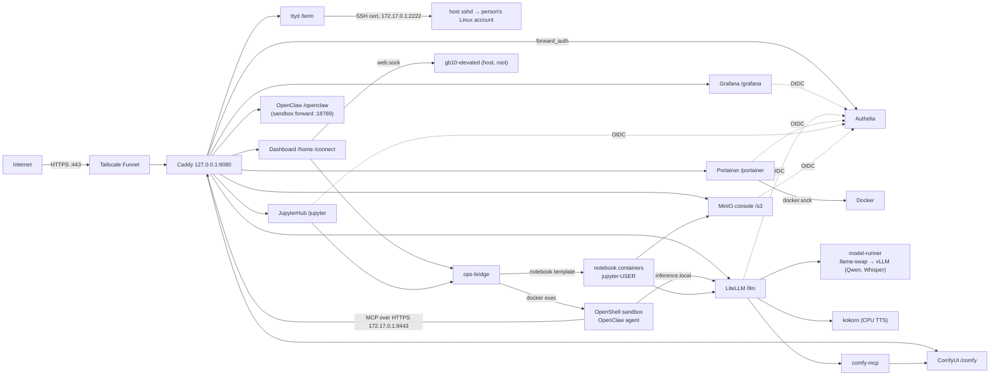

# GB10 Agent Stack: design

How the pieces fit together and why. To run it, see [`README.md`](README.md); for every setting, [`VARIABLES.md`](VARIABLES.md); for the root-owned host side (browser terminal, temporary sudo), [`host/README.md`](host/README.md).

## 1. Architecture

| Service | Role |
|---|---|
| `caddy` (host network) | Only entry point (`127.0.0.1:9080`, published by Funnel). Path routing and `forward_auth` to Authelia. Three more listeners on docker0, none published: `https://172.17.0.1:8443` serves only `/llm/*/mcp` to the sandbox; `http://172.17.0.1:9081` only the OIDC token and userinfo endpoints for Grafana, LiteLLM, Portainer and JupyterHub; `https://<PUBLIC_HOST>` bound to `172.17.0.1:443` (Caddy's internal CA) only the OIDC discovery, keys and token endpoints for MinIO (see §3) |
| `authelia` | Login portal, password + TOTP/passkey on every UI path, and the OpenID Connect provider for Portainer, Grafana, LiteLLM, JupyterHub and MinIO. Users in `authelia/users.yml` |
| `litellm` + `litellm-db` | OpenAI-compatible gateway at `/llm/v1`: virtual keys, rate limits, budgets, usage; MCP gateway; Prometheus + OTel. Models `agent`/`qwen3.6-35b`, `whisper` (alias `whisper-1`), `kokoro` (alias `tts-1`) |
| `model-runner` | llama-swap running vLLM: Qwen (`qwen3.6-35b`, kept loaded: `ttl: 0` + startup preload, group `agent` persistent) and Whisper large-v3-turbo (loaded on first request, unloaded after 5 idle minutes, its own group so it never evicts Qwen) |
| `kokoro` | Kokoro-FastAPI text-to-speech on the CPU, always on; reached only through LiteLLM |
| `comfyui`, `comfy-mcp` | FLUX schnell fp8; `comfy-mcp` exposes `generate_image` / `list_checkpoints` and returns a link, never image bytes |
| `admin-dashboard` | Landing page at `/home`: app tiles, notebook links, system status, and tabs *Models*, *Agent runtime* (OpenClaw devices) and *Temporary sudo* (admins); `/connect` |
| `ops-bridge` | Allow-listed commands in other containers and allow-listed container templates (`ops-bridge/actions.yaml`); the dashboard's only route into the sandbox and JupyterHub's only route to Docker |
| `jupyterhub` | JupyterHub at `/jupyter`, OIDC sign-in, starts one JupyterLab container per person through ops-bridge (`jupyterhub/bridge_spawner.py`); idle culler stops servers after an hour |
| `notebook-image` (build profile `images`) | The per-person JupyterLab image (`jupyter/`): NVIDIA PyTorch base, extensions, examples, `notebook-start` |
| `minio`, `minio-mc` | S3 storage (pgsty community fork of MinIO) and its admin tool; console at `/s3` with OIDC; S3 API reachable only on the `notebooks` network |
| `ttyd` | Browser terminal at `/term`; for each connection signs a one-minute SSH certificate and logs in to the host's dedicated sshd as the person (§7) |
| `portainer` | Portainer EE at `/portainer`: admins manage every container, `users` get private containers of their own (§9). Holds the read-write Docker socket |
| `docker-socket-proxy` | Read-only Docker API (`CONTAINERS`, `INFO`, `NETWORKS`, `POST=0`) for the dashboard and Alloy |
| `alloy`, `prometheus`, `loki`, `tempo`, `grafana`, `node-exporter`, `cadvisor`, `gpu-exporter` | Observability |
| NemoClaw (host CLI) | Creates and manages the OpenShell gateway and the sandbox `nemoclaw-assistant` (not compose services) |
| Host (`host/`, root) | Dedicated sshd, per-person Linux accounts synced from `users.yml`, the per-user nftables block, and the `gb10-elevated` sudo-grant daemon (not compose services) |

Networks: `ai` (apps), `obs` (telemetry), `notebooks` (JupyterHub, the notebook containers, LiteLLM, MinIO) and `term` (ttyd only; reaches the host's sshd through the docker0 gateway). Compose publishes only to `127.0.0.1` and `${DOCKER_BRIDGE_IP}` (LiteLLM `:4000`, Alloy `:4318` for the sandbox); every UI port is loopback, reached only through Caddy.

## 2. Routing

| Path | Upstream | Who |
|---|---|---|
| `/auth*` | Authelia | anyone |
| `/llm/v1/*` | LiteLLM | bearer key (Authelia bypassed; `Remote-*` headers stripped) |
| `/llm*` (UI, MCP) | LiteLLM; after Authelia the UI signs in again through OIDC | admins, and the `litellm` group (5 seats) |
| `/openclaw*` | sandbox forward `127.0.0.1:18789` (WebSocket) | admins, users |
| `/connect` | dashboard | admins, users |
| `/home/*` (landing page) | dashboard | admins, users (the page and its actions are filtered, see §6) |
| `/grafana*` | Grafana (OIDC, no `forward_auth`) | admins, users |
| `/portainer/*` | Portainer (OIDC, no `forward_auth`; prefix stripped, `--base-url /portainer`) | admins, users |
| `/jupyter*` | JupyterHub `127.0.0.1:8000` (OIDC, no `forward_auth`) and, through its proxy, each person's server | admins, users |
| `/s3/*` | MinIO console `127.0.0.1:9001` (OIDC, no `forward_auth`) | admins, users (the group names the MinIO policy) |
| `/term/*` | ttyd on a Unix socket (`data/ttyd/run`), `Remote-User` set by Caddy | admins, users |
| `/comfy/*` | ComfyUI | admins |
| `/brand/*`, `/favicon.ico`, `/get_favicon` | static files from `branding/` (public: login pages and Portainer's logo URL load them) | anyone |
| anything else, and the old `/admin` | redirect to `/home/` | |

Access rules live in `authelia/configuration.yml` (`default_policy: deny`, `two_factor`; session 12 h / 1 h idle; 3 failed logins = 30 min ban). Caddy forces `X-Forwarded-Proto: https` toward Authelia because Funnel traffic arrives as plain HTTP.

## 3. Authentication

| Client | Mechanism |
|---|---|
| Browser | Authelia session (password + TOTP or passkey). Dashboard, OpenClaw, Terminal, ComfyUI and the LiteLLM UI are checked by Caddy (`forward_auth`); Grafana, Portainer, LiteLLM, JupyterHub and MinIO sign in through OIDC (below). *Account* on the dashboard opens Authelia's settings (password, authenticators, security keys) |
| OIDC apps | Authelia clients `grafana`, `portainer`, `litellm`, `jupyterhub`, `minio` (`authelia/configuration.yml`; every sign-in needs two-factor). Grafana: `admins` → Admin, others Viewer. Portainer (EE): `admins` → Administrator, `users` team → Standard User. LiteLLM: only the `litellm` group may sign in (its SSO is free for 5 users), everyone starts as a viewer. JupyterHub: `admins` are Hub admins. MinIO: the `groups` claim names the policy (`minio/policies/admins.json`, `users.json`) |
| API clients | LiteLLM virtual key: `laptop` (any model, 30 rpm, $50 / 30 d), `scripts` (`agent`, 10 rpm), `openclaw-sandbox` (60 rpm, the only key with MCP access) |
| Notebooks | Each person's container gets their own LiteLLM key `nb-<user>` (10 rpm; `agent`, `whisper`, `kokoro`) and MinIO key, both derived from `secrets/jupyterhub_cred_secret` by `bridge_spawner.py` and created through ops-bridge (`litellm.key`, `s3.provision`), so nothing is stored and they are stable across restarts |
| Sandbox → LiteLLM | `openclaw-sandbox` key held in the OpenShell credential store; never inside the sandbox |
| Dashboard / JupyterHub → ops-bridge | Bearer tokens `secrets/bridge_dashboard_token`, `secrets/bridge_jupyterhub_token` (the Hub may call only `notebook.*`) |
| Terminal → host | ttyd trusts `Remote-User` (Caddy strips any client copy and refuses without it), signs a one-minute SSH certificate with `secrets/ssh_ca` for that principal; the host sshd accepts only certificates and only `gb10-users` |
| Dashboard → sudo daemon | `/run/gb10-elevate/web.sock`, owned by the dashboard container's uid 10001; the daemon itself checks the name is an enabled admin |

**OIDC plumbing.** Containers cannot reach the public hostname, and Authelia builds its issuer from `X-Forwarded-Proto/Host`, which these apps cannot set. Their browser-facing authorization URL is public; their server-side token and userinfo calls go to `http://172.17.0.1:9081` (Caddy), which adds the headers and passes nothing but those two paths. MinIO insists on fetching discovery and keys under the issuer's own name, so its container maps `<PUBLIC_HOST>` to docker0, where Caddy serves just the OIDC paths over HTTPS with its internal CA (`data/caddy-root.crt`, trusted by MinIO). The client secrets are in `secrets/` (Authelia keeps PBKDF2 hashes). Break-glass: Portainer `scripts/portainer-setup.sh local`, Grafana `/grafana/login?disableAutoLogin=true`, LiteLLM `/llm/fallback/login`, MinIO the root account through `minio-mc`.

**OpenClaw access.** NemoClaw rewrites `gateway.auth.token` at every sandbox start and OpenClaw refuses `trusted-proxy` while a token is set, so Authelia cannot sign you in directly. Instead: Authelia gates the URL; `/connect` (admins and users) reads the shared gateway token through ops-bridge and redirects to `/openclaw/#token=…` (no-store, no referrer, never logged); each browser must also be a paired device, approved in the dashboard. Per-person control is therefore the Authelia group, the device list and **Revoke** (which invalidates the token and removes the entry). The *Open for N min* enrollment window auto-approves new Control-UI pairings only (never scope upgrades or the CLI) and labels the device after the one person who opened `/connect` in the preceding 10 minutes; Funnel hides client IPs, so labels are hints.

## 4. Models and memory

- Agent model: `--gpu-memory-utilization 0.30` (~36 GB), `--max-model-len 262144` (KV cache 595,221 tokens, i.e. 2.27 full-length requests at once; it was 609k at 131072), 4 concurrent sequences. Multimodal, so there is no separate vision model.
- Whisper large-v3-turbo: `--gpu-memory-utilization 0.04` (~5 GB), port `10002`, loads in about 75 s on the first transcription and unloads after 5 idle minutes (`ttl: 300`). FlashAttention 2 has no `sm_121` kernels, so it runs with `--attention-backend TRITON_ATTN --mm-encoder-attn-backend TORCH_SDPA`. The llama-swap groups (`agent` persistent and exclusive, `speech` non-swapping) keep it from evicting Qwen.
- Kokoro runs on the CPU and takes no GPU memory.
- ComfyUI loads FLUX on demand (~20 to 25 GB) and the dashboard frees it after `COMFY_IDLE_MINUTES` (10).
- Notebooks get the GPU too, capped only in host memory (`NOTEBOOK_MEM_LIMIT`, 16g each); the GB10's unified memory cannot be partitioned, so a large notebook competes with everything above.
- Budget: keep Σ(`gpu-memory-utilization` × 121 GB) + ComfyUI peak + notebooks + 20 GB under ~115 GB.
- Cold start of the agent: ~330 s with empty caches, ~200 s afterwards (compile and CUDA JIT caches are on the `vllm_cache` volume).
- vLLM sizes its KV cache from free memory at start, so a ComfyUI load during that window breaks it. Do not generate images while the model loads.

## 5. Image generation path

Agent → OpenShell MCP proxy → `https://172.17.0.1:8443/llm/comfy_image/mcp` (Caddy, key-only, certificate from Caddy's CA which the sandbox trusts via `NEMOCLAW_CORPORATE_CA_BUNDLE`) → LiteLLM → `comfy-mcp` → ComfyUI. The tool returns text with an `image_url` and ready-made `markdown` (`https://<PUBLIC_HOST>/comfy/view?…`, loaded by the user's logged-in browser). OpenClaw would turn an inline image into a huge base64 string and overflow the context, hence links. It also hides MCP tools behind a search, so `nemoclaw-setup.sh notes` adds a line to the agent's `AGENTS.md` telling it to call `comfy_image-generate_image` and paste the returned markdown. The note lives in the sandbox workspace, not in git.

## 6. Dashboard and ops-bridge

The dashboard (FastAPI + HTMX, behind `/home`, flat dark monospace theme; logo and icons from `scripts/make-branding.py`) is the landing page for everyone. It shows the app tiles (ComfyUI for admins only), a *Notebooks* row (start/stop my server, my Voilà apps, all servers for admins), system status (memory, GPU, metrics via Prometheus), and a tabbed card: *Models* (LiteLLM model names and the API base URL, read from `litellm/config.yaml`, click to copy; admins also get load/unload and ComfyUI warm/free), *Agent runtime* (sandbox state and the *OpenClaw devices* list, approvals for admins) and *Temporary sudo* (admins). The chosen tab is kept in the URL hash and hidden tabs stop polling; visible ones refresh every 10 s. The container list was dropped (Portainer has it). The admin/user split is enforced in the app, not just hidden: every mutating route returns 403 for `users`, and `/api/status` omits container states for them.

`ops-bridge` is the only service besides Portainer with the read-write Docker socket. It has no published port, a read-only root, no capabilities and per-client tokens. `actions.yaml` is the complete list of what it can do: kinds `exec`, `restart`, `logs`, plus container `templates` (`notebook`: fixed image, network, memory, GPU and volume `jupyter-<user>`; the caller supplies only a validated name and allow-listed environment variables, and may stop or inspect only containers the bridge created). Parameters are matched against patterns and passed as separate argv elements, never through a shell; every call is audited, and `sensitive` actions log neither parameters nor output. The OpenClaw actions enter the sandbox's nested network namespace as the sandbox user and read the gateway token from `openclaw.json`. To let another service do something, add a client and actions to the file; no code change.

## 7. Notebooks, storage and speech

- **JupyterHub** signs people in through Authelia and asks ops-bridge to start the `notebook` template for them; it has no Docker access itself. Each server has the person's volume (`/work`), their keys as environment variables (`OPENAI_*`, `AWS_*`), the GPU and a memory cap; idle servers are culled after an hour. Extensions: Git, jupyter-ai (default model `agent`, thinking off), jupyter-fsspec storage browser, Voilà (preview panel allowed by `frame-ancestors 'self'` in `jupyter/jupyter_server_config.py`), papermill, resource usage.
- **MinIO** holds one bucket per person (`u-<user>`, 50 GiB quota) and `shared` (everyone reads, each writes under `shared/<user>/`). The console signs in through OIDC; the S3 API is only on the `notebooks` network. `minio-mc` runs `minio/init.sh` (policies, `shared` bucket) and the `s3.provision` action.
- **Speech** is two more model names on the same LiteLLM endpoint and keys (`/llm/v1/audio/transcriptions`, `/llm/v1/audio/speech`).

## 8. Browser terminal and temporary sudo

`/term/` gives each person a login shell on the GB10 itself, as their own Linux account (uid 20000-29999, group `gb10-users`, no sudo or docker group, systemd limits 16G / 1024 tasks / 400% CPU). `host/sync-accounts.sh` creates and disables accounts from `users.yml` every 5 minutes and never touches names it did not create. The path: Caddy (Authelia two-factor) → ttyd on a Unix socket → `ttyd/gb10-shell` signs a one-minute certificate → dedicated sshd on `172.17.0.1:2222` (certificates only, no forwarding, `UsePAM yes`). The session ends when the tab closes or the shell exits; `tmux` is installed for people who want one to persist. The **per-user network block** (`host/gb10-users.nft`) stops these uids from reaching loopback ports, the machine's own addresses and Docker's networks, which matters because the dashboard, ComfyUI and Portainer listen on loopback and trust headers; Caddy `:9080`, DNS and the internet stay open, and TCP resets are let through so closed ports refuse at once.

**Temporary sudo** (admins only): the dashboard's *Temporary sudo* tab sends the signed-in name, a reason and 5/15/30/60 minutes to the root daemon `gb10-elevated` over `web.sock`. The daemon checks the person is an enabled admin with a terminal account, writes `/etc/sudoers.d/gb10-grant-<uid>` (checked by `visudo -cf`), and on expiry or **End now** / `gb10-elevate drop` removes it and kills that login's root processes. Everything is recorded: a 30-day append-only grant log, sudo I/O recordings (`sudoreplay`), syslog and an auditd rule; the tab lists events and offers downloads. It is a deterrent and a record, not tamper-proof: root can erase its own traces. Details in [`host/README.md`](host/README.md).

## 9. Security model

| Control | Detail |
|---|---|
| Public surface | Only Funnel `:443`. Caddy binds loopback for the public site; the MCP, OIDC and MinIO-discovery listeners bind docker0 (`172.17.0.1`) and are not published |
| Human auth | Authelia two-factor everywhere, deny by default, brute-force lockout |
| Machine auth | LiteLLM keys with model allow-lists, rate limits, budgets |
| Header spoofing | `forward_auth` overwrites identity headers; `/llm/v1` and the MCP listener strip them; Caddy removes any client `Remote-User` before ttyd. The dashboard still trusts `Remote-*` from anything on `ai-stack_ai` (see Portainer users); Grafana no longer trusts headers |
| Sandbox | NemoClaw Balanced policy; inference only via `inference.local`; MCP only to `172.17.0.1:8443`; no telemetry egress yet |
| Docker socket | rw for `ops-bridge` and `portainer`. Treat both as root-equivalent: keep `actions.yaml` short, and give `admins` only to people who may run anything on the host. Others use the read-only proxy. `cadvisor` runs privileged |
| Portainer users | `users` can start containers (GPU requests allowed) that stay private to them; bind mounts, privileged mode, host namespaces, devices, capabilities, sysctls, security options and stacks are blocked. **Accepted gap:** Portainer does not stop a user's container from using host networking or joining `ai-stack_ai`, which reaches the header-trusting dashboard, so treat `users` as trusted. Published ports and resources are not limited. The fix, if needed: a filtering proxy in front of Portainer's socket and a Caddy-issued secret for header-trusting services |
| Notebooks | Containers come only from the bridge's template (no user-chosen image, mounts or privileges); on the `notebooks` network they reach LiteLLM, MinIO and the internet (and the LAN), not the rest of the stack. GPU and memory are shared |
| Host shell | Unprivileged accounts with systemd limits and the per-uid network block; certificate-only sshd. A shell on the machine that holds every secret is the weakest point: keep the host patched |
| Temporary sudo | Admins only, two-factor, time-boxed, recorded; root can bypass the network block and remove its own traces, so grant it only to people you would give the machine to |
| Caddy CA | Its key is in the `caddy_data` volume and the sandbox and MinIO trust its root: protect the volume. Losing it means a new root and a re-onboard |
| Secrets | `secrets/` (700), never in `.env` or the sandbox. Some files are mode 644 because non-root containers read them (`litellm_master_key`, `grafana_admin_password`, `grafana_oidc_secret`, the bridge tokens, `jupyterhub_cred_secret`); `ssh_ca` is 600 and owned by `TTYD_UID` |

## 10. Observability

Alloy receives OTLP (LiteLLM and vLLM traces), ships container logs (via the socket proxy) to Loki, spans to Tempo and span metrics to Prometheus. Prometheus scrapes node-exporter, cAdvisor, LiteLLM (`/llm/metrics`, master key), vLLM (`model-runner:10001` for Qwen, `:10002` for Whisper; each down while its model is unloaded), Alloy, Tempo and Loki. DCGM does not work on GB10 unified memory, so `gpu-exporter` writes `nvidia-smi` values to node-exporter's textfile collector. Grafana ships one board (`gb10-overview.json`). node-exporter runs with `--no-collector.cpufreq`, which hangs on the GB10. No alerts are provisioned.

## 11. Updating

Image tags are pinned in `.env.example` (arm64, verified). Bump deliberately and retest; never use `latest`. `postgres` must keep its major version on an existing volume. `JUPYTERHUB_VERSION` is used by both the Hub and the notebook image: rebuild both. MinIO's tags come from the community fork (upstream images are gone). To change build-time sandbox settings (image input, reasoning, CA), re-run `scripts/nemoclaw-setup.sh onboard`, then `mcp`, `config`, `notes`. Host scripts (`host/setup.sh`, `host/elevate-setup.sh`) are safe to re-run after pulling changes to `host/`.
