# GB10 Agent Stack — v2

> **NemoClaw · OpenClaw · OpenShell** on a single **NVIDIA GB10** (DGX Spark class · 128 GB unified memory · arm64 · DGX OS / Ubuntu 24.04).
> **One public HTTPS port** via Tailscale Funnel → **one reverse proxy** → **path-based routing** → **every route authenticated**.
> Everything that runs as a service is a **container**.

---

## Table of contents

1. [What changed from v1](#1-what-changed-from-v1)
2. [At a glance](#2-at-a-glance)
3. [Architecture](#3-architecture)
4. [Path routing (single port)](#4-path-routing-single-port)
5. [Authentication](#5-authentication)
6. [LLM gateway](#6-llm-gateway)
7. [Containerisation decisions](#7-containerisation-decisions)
8. [Container inventory & networks](#8-container-inventory--networks)
9. [Monitoring & observability](#9-monitoring--observability)
10. [Memory budget](#10-memory-budget)
11. [Model lifecycle (scale-to-zero)](#11-model-lifecycle-scale-to-zero)
12. [Request flows](#12-request-flows)
13. [Configuration](#13-configuration)
14. [Admin dashboard](#14-admin-dashboard)
15. [MCPs & Skills](#15-mcps--skills)
16. [Security model](#16-security-model)
17. [Bring-up runbook](#17-bring-up-runbook)
18. [Verification checklist](#18-verification-checklist)
19. [Open items to verify](#19-open-items-to-verify)

---

## 1. What changed from v1

| Area | v1 | **v2** |
|---|---|---|
| Exposure | Tailnet-only, 3 ports | **Public via Tailscale Funnel, single port 443** |
| Routing | Mixed ports + paths | **Pure path-based** behind Caddy |
| Auth | Tailscale identity headers | **Authelia SSO + 2FA** (forward-auth) for humans, **LiteLLM virtual keys** for machines |
| Model API | llama-swap exposed directly | **LiteLLM gateway** → llama-swap → vLLM |
| llama-swap | Host systemd, spawning `docker run` | **Container** — llama-swap baked into the vLLM image, spawns `vllm serve` as child processes |
| Dashboard | Host systemd | **Container** + read-only docker-socket-proxy |
| OpenShell gateway | Host process | **Container** (`ghcr.io/nvidia/openshell/gateway`) |
| Monitoring | none | **Grafana · Prometheus · Loki · Tempo · Alloy** + GB10-aware GPU exporter + OpenClaw/LiteLLM/vLLM OTel traces |

---

## 2. At a glance

| Layer | Choice | Notes |
|---|---|---|
| Ingress / TLS | **Tailscale Funnel** `:443` | Public HTTPS on `gb10.<tailnet>.ts.net`; TLS terminated by Tailscale |
| Reverse proxy | **Caddy** `127.0.0.1:9080` | Plain HTTP, path routing, forward-auth |
| Identity | **Authelia** | File users, TOTP / WebAuthn (passkeys), brute-force regulation, default-deny ACL |
| LLM gateway | **LiteLLM Proxy** + Postgres | Virtual keys, budgets, rate limits, fallbacks, Prometheus + OTel, MCP gateway |
| Model runner | **llama-swap + vLLM** (one container) | Spawns/kills `vllm serve` per model on demand |
| Agent LLM | `nvidia/Qwen3.6-35B-A3B-NVFP4` | NVIDIA's DGX Spark default for OpenClaw |
| Vision | Agent model if multimodal, else `Qwen/Qwen3-VL-30B-A3B-Instruct` | |
| Image gen | **ComfyUI** + FLUX.1-schnell / Z-Image-Turbo, **comfy-mcp** | |
| Agent | **OpenClaw** in an **OpenShell** sandbox, onboarded by **NemoClaw** | |
| Admin | **admin-dashboard** (FastAPI + HTMX) | Status, Up/Down, idle unloader |
| Observability | **Alloy → Prometheus / Loki / Tempo → Grafana** | GPU via `nvidia-smi` textfile (DCGM is broken on GB10) |

---

## 3. Architecture

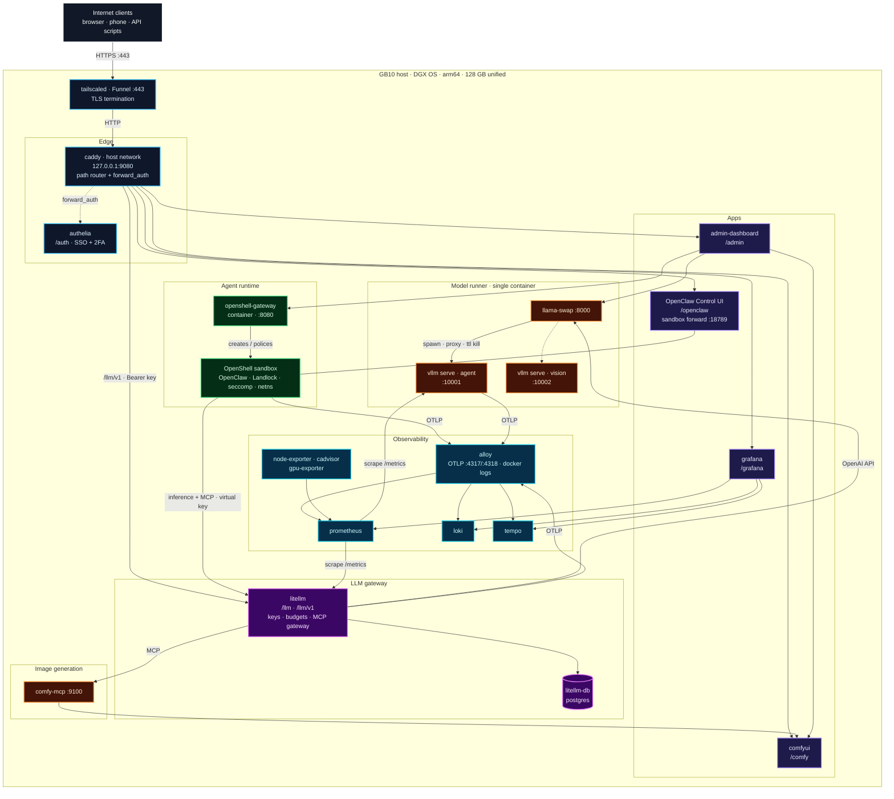

---

## 4. Path routing (single port)

**Public URL:** `https://gb10.<tailnet>.ts.net` (Funnel `:443` → Caddy `127.0.0.1:9080`)

| Path | Upstream | Auth | Prefix handling | Sub-path support |
|---|---|---|---|---|
| `/` | redirect → `/admin/` | — | — | — |
| `/auth/*` | authelia `127.0.0.1:9091` | public (login portal) | kept · `server.address: …/auth` | native |
| `/admin/*` | admin-dashboard `127.0.0.1:9000` | Authelia · `admins` · 2FA | stripped · `uvicorn --root-path /admin` | native |
| `/openclaw/*` | OpenClaw `127.0.0.1:18789` | Authelia → OpenClaw `trusted-proxy` | kept · `gateway.controlUi.basePath: "/openclaw"` | native |
| `/llm/v1/*` | litellm `127.0.0.1:4000` | **LiteLLM virtual key** (Bearer) | kept · `SERVER_ROOT_PATH=/llm` | native |
| `/llm/*` (UI) | litellm `127.0.0.1:4000` | Authelia · `admins` · 2FA + LiteLLM login | kept | native |
| `/grafana/*` | grafana `127.0.0.1:3000` | Authelia · `admins` → Grafana auth-proxy | kept · `serve_from_sub_path = true` | native |
| `/comfy/*` | comfyui `127.0.0.1:8188` | Authelia · `admins` · 2FA | stripped | **fragile** — see note |

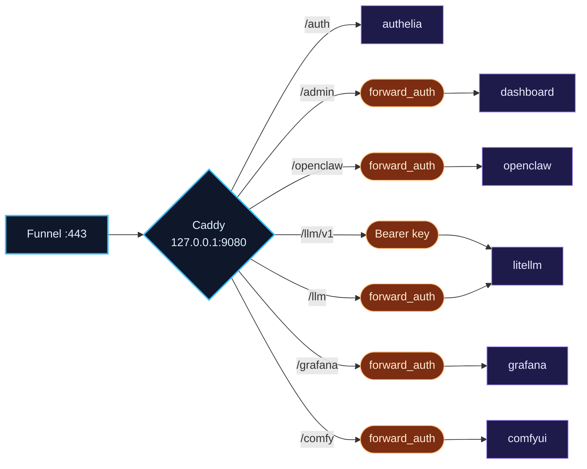

> **ComfyUI under `/comfy/`:** ComfyUI has open issues where parts of the frontend build absolute URLs (`/api/view`, `/view`) and some frontend releases break sub-path routing entirely. Mitigations, in order:
> 1. Pin a ComfyUI frontend version you have tested under `/comfy/`.
> 2. Keep image generation agent-driven (OpenClaw → MCP → ComfyUI) and treat the ComfyUI UI as a power-user tool.
> 3. If it keeps breaking, expose it on Funnel `:8443` or keep it tailnet-only — the only exception to the single-port rule.

---

## 5. Authentication

### Model

| Client type | Mechanism | Where enforced |
|---|---|---|
| Humans (browser) | **Authelia** session cookie, password + **TOTP / WebAuthn** | Caddy `forward_auth` on every UI path |
| OpenClaw UI | Authelia → `Remote-Email` header → OpenClaw **`trusted-proxy`** mode | Caddy + OpenClaw |
| Grafana | Authelia → `Remote-User` header → Grafana **auth.proxy** | Caddy + Grafana |
| API scripts / laptop | **LiteLLM virtual key** (`Authorization: Bearer sk-…`) | LiteLLM |
| OpenClaw sandbox → models/MCP | LiteLLM virtual key held in **OpenShell credential store** (never in the sandbox) | OpenShell L7 proxy + LiteLLM |
| Internal service ↔ service | Docker network isolation, no host publish | Docker |

### Login flow

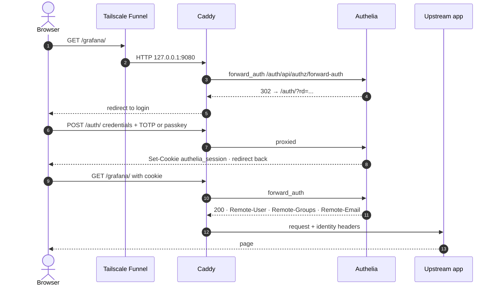

### Groups & policy

| Group | Access |
|---|---|
| `admins` | Everything (`/admin`, `/grafana`, `/comfy`, `/llm` UI, `/openclaw`) |
| `users` | `/openclaw` only |
| everyone else | **deny** (`default_policy: deny`) |

---

## 6. LLM gateway

**LiteLLM Proxy** sits between every consumer and the local models.

| Capability | Use here |
|---|---|
| OpenAI-compatible API | Single base URL `https://gb10…/llm/v1` for everything |
| Virtual keys | `openclaw-sandbox`, `laptop`, `scripts` — revocable, per-key model allow-lists |
| Budgets & rate limits | RPM/TPM caps per key; protects the box from runaway agents |
| Model aliases & fallbacks | `agent` → `qwen3.6-35b`; vision fallback; optional cloud fallback |
| Timeouts | 900 s to cover vLLM cold starts |
| Observability | Prometheus `/metrics` (latency, TTFT, tokens, spend per key) + **OTel traces** |
| **MCP gateway** | Fronts `comfy-mcp` so the sandbox only needs **one** egress destination |
| Admin UI | `/llm/ui` — keys, usage, logs |

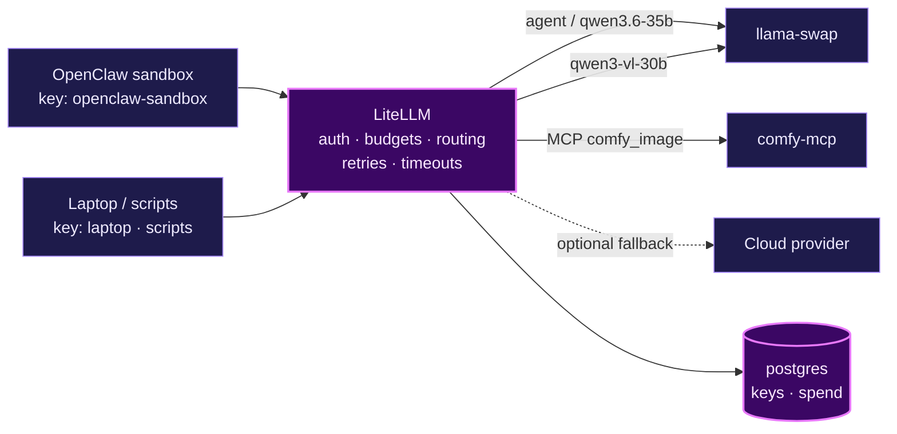

---

## 7. Containerisation decisions

| Component | Containerised? | How | Caveats |
|---|---|---|---|
| **llama-swap** | **Yes** | Custom image `FROM nvcr.io/nvidia/vllm` + llama-swap binary. llama-swap spawns `vllm serve` **as child processes** inside the same container | No docker socket needed. Container stays up (tiny); models come and go |
| **admin-dashboard** | **Yes** | Python image + `openshell` CLI; Docker status via **read-only** `docker-socket-proxy` | Can't call host `nemoclaw`; uses OpenShell gateway API/CLI instead |
| **OpenShell gateway** | **Yes** | Official `ghcr.io/nvidia/openshell/gateway` with Docker driver: mounts `/var/run/docker.sock`, supervisor binary at **identical host path**, callback `host.openshell.internal:8080` | Port **8080 must be published as 8080**. Socket access ≈ root |
| **OpenClaw sandbox** | Already a container | Created by OpenShell, not by compose | Lifecycle via `nemoclaw` / `openshell` |
| **NemoClaw** | **No — host CLI** | Onboarding & lifecycle commands; not a daemon | Point it at the containerised gateway (verify "reuse existing gateway") |
| **tailscaled** | Host (recommended) | Funnel to host-loopback Caddy | Can be containerised with `network_mode: host` if desired |

### Why llama-swap inside the vLLM image

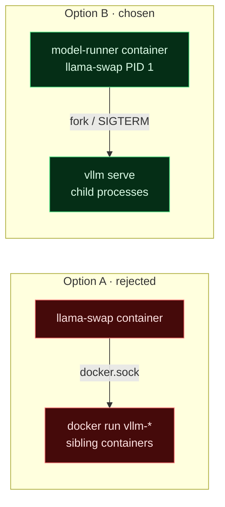

| | A · sibling containers | **B · child processes** |
|---|---|---|
| Docker socket | Required (root-equivalent) | **Not required** |
| Cold start | Container create + vLLM load | vLLM load only |
| Memory freed on idle | Yes | Yes (process exit) |
| Mix vLLM + llama.cpp | Easy | Add `llama-server` binary to the image |

---

## 8. Container inventory & networks

### Inventory

| # | Service | Image (arm64) | Host publish | Docker net | Lifecycle |
|---|---|---|---|---|---|
| 1 | caddy | `caddy:2-alpine` | `127.0.0.1:9080` (host network) | host | always |
| 2 | authelia | `authelia/authelia:4` | `127.0.0.1:9091` | `ai` | always |
| 3 | litellm | `ghcr.io/berriai/litellm:<pinned>` | `127.0.0.1:4000`, `172.17.0.1:4000` | `ai`, `obs` | always |
| 4 | litellm-db | `postgres:17-alpine` | — | `ai` | always |
| 5 | model-runner | built: `nvcr.io/nvidia/vllm:<TAG>` + llama-swap | — | `ai`, `obs` | always · **models on demand** |
| 6 | comfyui | built: `nvcr.io/nvidia/pytorch:<TAG>-py3` | `127.0.0.1:8188` | `ai` | always · **weights on demand** |
| 7 | comfy-mcp | built: `python:3.12-slim` | — | `ai` | always |
| 8 | openshell-gateway | `ghcr.io/nvidia/openshell/gateway:<pinned>` | `172.17.0.1:8080` | `ai` | always |
| 9 | *(OpenClaw sandbox)* | NemoClaw blueprint | `127.0.0.1:18789` (forward) | OpenShell-managed | always |
| 10 | admin-dashboard | built: `python:3.12-slim` | `127.0.0.1:9000` | `ai`, `obs` | always |
| 11 | docker-socket-proxy | `tecnativa/docker-socket-proxy` | — | `ai` | always |
| 12 | alloy | `grafana/alloy:<pinned>` | — | `obs` | always |
| 13 | prometheus | `prom/prometheus:<pinned>` | — | `obs`, `ai` | always |
| 14 | loki | `grafana/loki:<pinned>` | — | `obs` | always |
| 15 | tempo | `grafana/tempo:<pinned>` | — | `obs` | always |
| 16 | grafana | `grafana/grafana-oss:<pinned>` | `127.0.0.1:3000` | `obs` | always |
| 17 | node-exporter | `prom/node-exporter:<pinned>` | — | `obs` | always |
| 18 | cadvisor | `gcr.io/cadvisor/cadvisor:<pinned ≥ Docker 25 support>` | — | `obs` | always |
| 19 | gpu-exporter | built: `ubuntu:24.04` + `nvidia-smi` loop | — | (textfile volume) | always |

> `172.17.0.1` is the default `docker0` bridge address (`host.openshell.internal` for sandboxes). Confirm with `ip -4 addr show docker0`. It is **not** reachable from outside the host.

### Networks & exposure

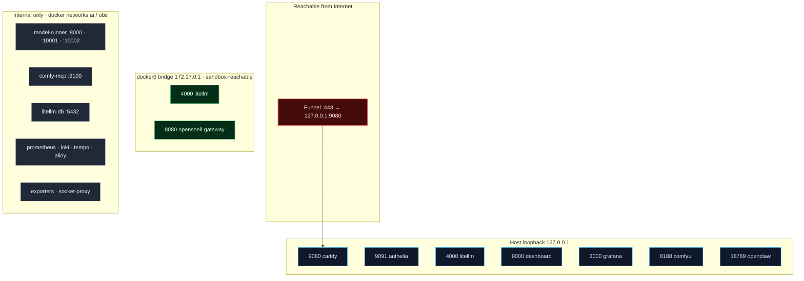

---

## 9. Monitoring & observability

### Stack

| Signal | Source | Collector | Store | View |
|---|---|---|---|---|
| **GPU** (util, temp, power, clocks) | `nvidia-smi` → textfile | node-exporter | Prometheus | Grafana |
| **Unified memory** | `/proc/meminfo` (`MemAvailable`, swap) | node-exporter | Prometheus | Grafana |
| Host CPU / disk / net | kernel | node-exporter | Prometheus | Grafana |
| Container CPU / mem | cgroups | cAdvisor | Prometheus | Grafana |
| **vLLM** (running/waiting reqs, KV-cache %, TTFT, TPOT, tokens/s) | `vllm serve` `/metrics` on `:10001/:10002` | Prometheus scrape | Prometheus | Grafana (vLLM dashboard) |
| vLLM traces | `--otlp-traces-endpoint` | Alloy | Tempo | Grafana |
| **LiteLLM** (requests, latency, TTFT, tokens, spend per key/model, failures) | `/metrics` + OTel callback | Prometheus + Alloy | Prometheus + Tempo | Grafana |
| **OpenClaw traces** (run, model call, tool exec, skill, message flow) | `diagnostics-otel` plugin, OTLP/HTTP | Alloy | Tempo | Grafana |
| OpenClaw metrics (tokens, cost, run duration, tool usage, queues) | `diagnostics-otel` | Alloy → remote-write | Prometheus | Grafana |
| Logs (all containers) | Docker | Alloy | Loki | Grafana |
| Model up/down state | `up{job="vllm-*"}` (scrape fails when scaled to zero) | Prometheus | Prometheus | Grafana + dashboard |

### Topology

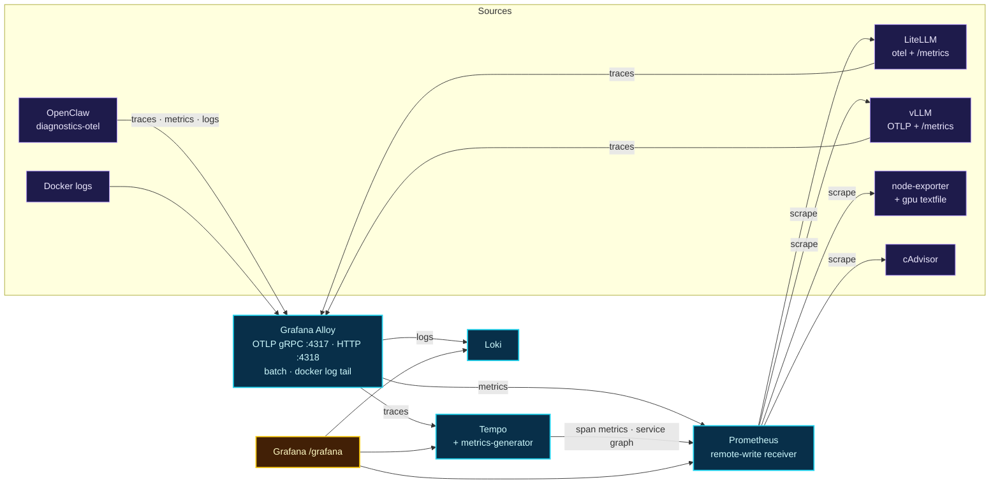

### End-to-end trace

OpenClaw sends a W3C `traceparent` on provider calls → LiteLLM continues the trace → vLLM continues it. One Tempo trace shows:

```text
openclaw.run ─────────────────────────────────────────────────────────── 14.2 s
├─ openclaw.context.assembly ──── 0.1 s
├─ openclaw.model.call ─────────────────────────────── 9.8 s
│  └─ litellm.request (qwen3.6-35b, key=openclaw-sandbox) ── 9.7 s
│     └─ vllm.llm_request ── ttft 0.42 s · 612 out tokens ── 9.6 s
├─ openclaw.tool.execution  generate_image ─────── 4.1 s
│  └─ litellm.mcp.call comfy_image.generate_image ── 4.0 s
└─ openclaw.model.call ─ 0.2 s
```

### GPU on GB10 — why not DCGM

`dcgm-exporter` does not work properly on GB10 unified memory, and NVML returns `N/A` for many memory fields. Use:

- `nvidia-smi --query-gpu=utilization.gpu,temperature.gpu,power.draw,clocks.sm` → `.prom` textfile every 10 s
- `/proc/meminfo` `MemAvailable` + `SwapFree` for real allocatable memory (NVIDIA's own guidance for UMA)
- A **staleness alert** on the textfile timestamp so a dead collector doesn't look like a healthy idle GPU

Reference implementation worth reading: `cadaverine/dgx-spark-observability` (GB10 quirks documented).

### Grafana dashboards

| Dashboard | Source |
|---|---|
| **GB10 Host** | Custom: GPU util/temp/power, `MemAvailable`, swap, per-container memory, model up/down |
| **vLLM** | Upstream vLLM Grafana JSON (examples in vLLM repo) |
| **LiteLLM** | Upstream LiteLLM Grafana JSON |
| **OpenClaw** | Custom from exported metric names (tokens, cost, run duration, tool usage) |
| **Traces** | Grafana Explore → Tempo (service graph via metrics-generator) |
| **Logs** | Grafana Explore → Loki, label `container` |

### Suggested alerts (Grafana alerting)

| Alert | Condition |
|---|---|
| Memory pressure | `MemAvailable < 12 GB` for 5 m |
| Swap thrash | `rate(pswpin) > X` for 5 m |
| GPU collector stale | textfile mtime > 60 s |
| GPU hot | temp > 85 °C for 5 m |
| Model stuck starting | llama-swap starting > 15 m |
| LiteLLM errors | 5xx rate > 5 % for 5 m |
| Auth brute force | Authelia regulation bans > 0 |

---

## 10. Memory budget

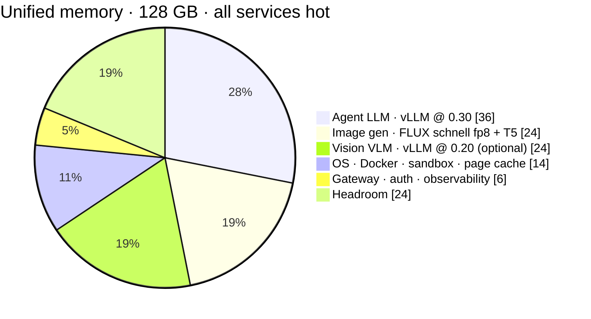

| Service | Setting | Approx. |
|---|---|---|
| vllm agent | `--gpu-memory-utilization 0.30 --max-model-len 65536 --max-num-seqs 4` | ~36 GB |
| vllm vision | `--gpu-memory-utilization 0.20 --max-model-len 32768 --max-num-seqs 2` | ~24 GB |
| comfyui | FLUX.1-schnell fp8 + T5-XXL fp8 | ~20–25 GB hot · ~1 GB after `/free` |
| litellm + postgres + authelia + caddy | — | ~1.5 GB |
| prometheus + loki + tempo + grafana + alloy + exporters | 30-day retention | ~4–5 GB |

> Keep **Σ gpu-memory-utilization × 121 GB + ComfyUI peak + 20 GB < 115 GB**.

---

## 11. Model lifecycle (scale-to-zero)

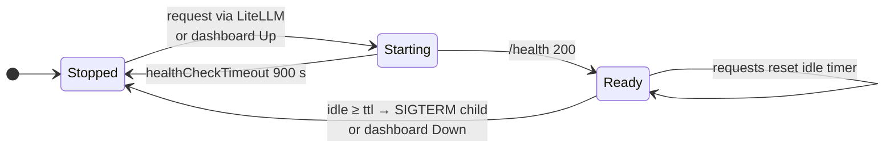

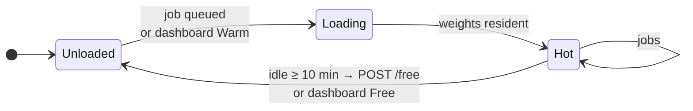

| Model | Owner | Idle policy | Cold start |
|---|---|---|---|
| Agent LLM | llama-swap (in model-runner) | `ttl: 1800` | ~2–5 min |
| Vision VLM | llama-swap | `ttl: 900` | ~2–4 min |
| Image gen | dashboard idle watcher | 10 min → `/free` | ~20–60 s |

---

## 12. Request flows

### 12.1 Agent chat (cold start, fully traced)

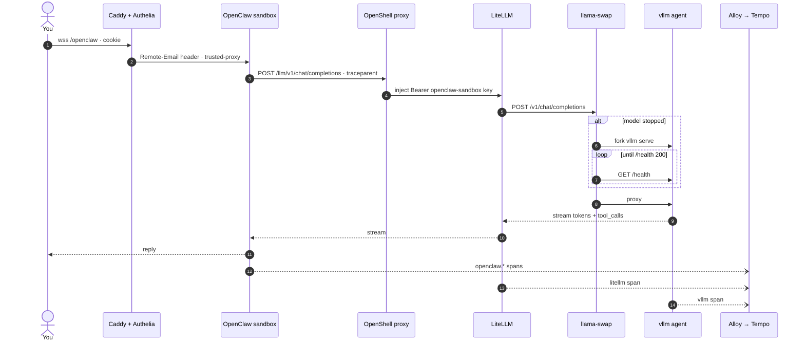

### 12.2 Image generation via LiteLLM MCP gateway

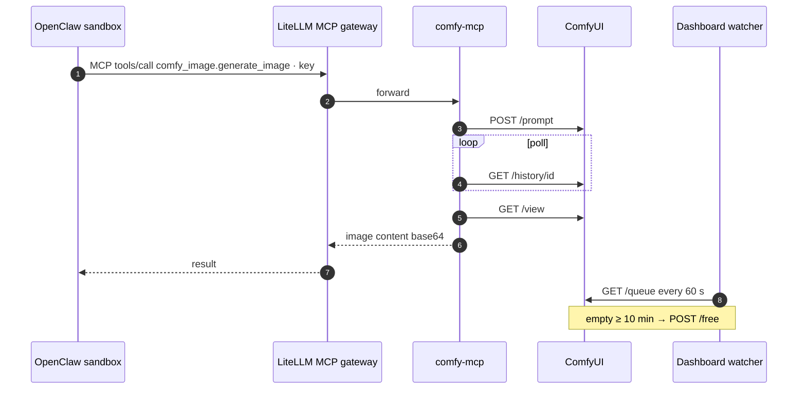

### 12.3 External API client

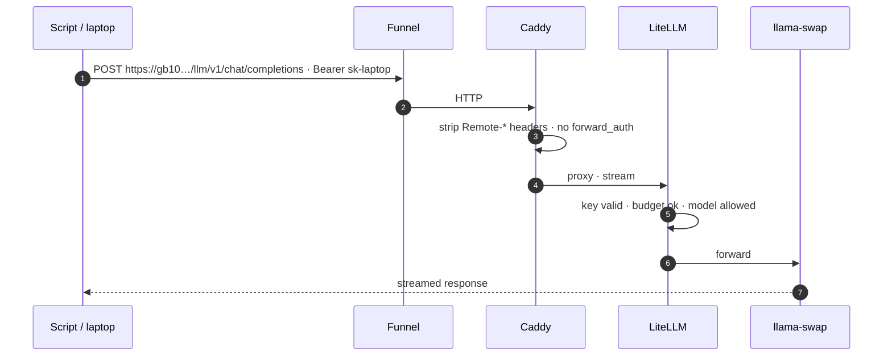

---

## 13. Configuration

All files live in [`ai-stack/`](ai-stack/). Deploy that folder to `/srv/ai-stack` on the GB10.

### 13.1 Project files

```text
ai-stack/
├── compose.yaml                         # 18 services (the OpenClaw sandbox is created by OpenShell)
├── .env.example                         # copy → .env (no secrets)
├── .gitignore
├── scripts/
│   ├── init-secrets.sh                  # generates secrets/, .env, users.yml (never overwrites)
│   └── create-litellm-keys.sh           # openclaw-sandbox · laptop · scripts keys → secrets/litellm_keys.json
├── secrets/                             # git-ignored · chmod 700
├── caddy/Caddyfile
├── authelia/
│   ├── configuration.yml                # templated with PUBLIC_HOST
│   └── users.yml.example
├── litellm/config.yaml
├── model-runner/
│   ├── Dockerfile                       # vLLM image + llama-swap + OTel libs
│   └── llama-swap.yaml
├── comfyui/
│   ├── Dockerfile                       # NVIDIA PyTorch base, keeps CUDA torch
│   └── workflows/flux-schnell-api.json  # API-format FLUX schnell workflow
├── comfy-mcp/
│   ├── Dockerfile
│   ├── requirements.txt
│   └── server.py                        # tools: generate_image · list_checkpoints
├── dashboard/
│   ├── Dockerfile
│   ├── requirements.txt
│   ├── app.py                           # FastAPI · status · Up/Down · ComfyUI idle unloader
│   └── templates/{index.html, partials/status.html}
├── openclaw/openclaw.snippet.json5      # merge into OpenClaw config inside the sandbox
├── openshell/                           # gateway notes / state placeholder
└── observability/
    ├── alloy/config.alloy
    ├── prometheus/prometheus.yml
    ├── loki/config.yaml
    ├── tempo/config.yaml
    ├── grafana/
    │   ├── provisioning/datasources/datasources.yaml
    │   ├── provisioning/dashboards/dashboards.yaml
    │   └── dashboards/gb10-overview.json
    └── gpu-exporter/{Dockerfile, collect.sh}
```

| File | Purpose | Key settings |
|---|---|---|
| [`compose.yaml`](ai-stack/compose.yaml) | Every service, network, volume, secret | Caddy `network_mode: host`; LiteLLM + OpenShell gateway + Alloy OTLP also published on `${DOCKER_BRIDGE_IP}` for sandboxes |
| [`.env.example`](ai-stack/.env.example) | Host + pinned image tags | `PUBLIC_HOST`, `DOCKER_BRIDGE_IP`, `DOCKER_GID`, `MODELS_DIR`, all `*_IMAGE` |
| [`caddy/Caddyfile`](ai-stack/caddy/Caddyfile) | Single-port path router | `forward_auth` → Authelia; `/llm/v1` key-only + `Remote-*` stripped; 15 min streaming timeouts |
| [`authelia/configuration.yml`](ai-stack/authelia/configuration.yml) | SSO + 2FA | `default_policy: deny`; `admins` vs `users`; regulation 3 / 2 m / 30 m |
| [`litellm/config.yaml`](ai-stack/litellm/config.yaml) | LLM + MCP gateway | `agent` alias; 900 s timeouts; `comfy_image` MCP; `prometheus` + `otel` callbacks |
| [`model-runner/llama-swap.yaml`](ai-stack/model-runner/llama-swap.yaml) | On-demand vLLM | Fixed ports 10001/10002; `gpu-memory-utilization` 0.30 / 0.20; `ttl` 1800 / 900 |
| [`comfy-mcp/server.py`](ai-stack/comfy-mcp/server.py) | ComfyUI → MCP | Streamable HTTP on `:9100/mcp`; returns PNG + JSON metadata |
| [`dashboard/app.py`](ai-stack/dashboard/app.py) | Admin UI | `Remote-Groups ∋ admins` for mutations; idle watcher calls ComfyUI `/free` |
| [`openclaw/openclaw.snippet.json5`](ai-stack/openclaw/openclaw.snippet.json5) | OpenClaw gateway | `basePath: /openclaw`; `trusted-proxy` + `allowLoopback`; `diagnostics-otel` → `host.openshell.internal:4318` |
| [`observability/…`](ai-stack/observability/) | Metrics, logs, traces | Alloy OTLP → Prometheus / Loki / Tempo; Tempo span metrics; GB10 textfile GPU exporter |

### 13.2 NemoClaw onboarding

| Prompt | Answer |
|---|---|
| Gateway | **Reuse existing** → containerised `openshell-gateway` (`openshell gateway add http://172.17.0.1:8080`) |
| Express install | **No** (custom) |
| Inference provider | OpenAI-compatible → `http://host.openshell.internal:4000/llm/v1`, key = `openclaw-sandbox` |
| Model | `agent` |
| Sandbox name | `my-assistant` (must match `NEMOCLAW_SANDBOX`) |
| Policy preset | **Balanced** + allow egress to `host.openshell.internal:4000` (LiteLLM) and `:4318` (OTLP) |

### 13.3 Tailscale Funnel

```bash
sudo tailscale funnel --bg http://127.0.0.1:9080     # public :443 → Caddy
tailscale funnel status
```

The tailnet policy must grant the node the `funnel` node attribute.

---

## 14. Admin dashboard

```text
┌──────────────────────────────────────────────────────────────────────────────┐
│  GB10 · AI Stack                     you (admins)  ● Funnel  ● Authelia  [⎋] │
├──────────────────────────────────────────────────────────────────────────────┤
│  Unified memory ███████████████████░░░░░░░░░░░░  71 / 128 GB  GPU 18% · 54°C │
├──────────────────────────┬───────────┬─────────┬────────────┬───────────────┤
│ Model                    │ State     │ Memory  │ Idle / TTL │ Actions       │
├──────────────────────────┼───────────┼─────────┼────────────┼───────────────┤
│ Agent · Qwen3.6 35B      │ ● Ready   │ 36 GB   │ 4m / 30m   │ [Down]        │
│ Vision · Qwen3-VL 30B    │ ○ Stopped │ —       │ —          │ [Up]          │
│ Image · FLUX schnell     │ ◐ Idle    │ 1 GB    │ 7m / 10m   │ [Warm] [Free] │
├──────────────────────────┴───────────┴─────────┴────────────┴───────────────┤
│ Services                                                                     │
│  ● caddy  ● authelia  ● litellm  ● litellm-db  ● model-runner  ● comfyui     │
│  ● comfy-mcp  ● openshell-gateway  ● sandbox:my-assistant  ● openclaw        │
│  ● prometheus  ● loki  ● tempo  ● grafana  ● alloy  ● gpu-exporter (8s ago)  │
├──────────────────────────────────────────────────────────────────────────────┤
│ Quick links:  /openclaw   /llm/ui   /grafana   /comfy                        │
└──────────────────────────────────────────────────────────────────────────────┘
```

| Method | Path (under `/admin`) | Action |
|---|---|---|
| `GET` | `/` | HTML (HTMX polls `/partials/status` every 5 s) |
| `GET` | `/api/status` | Aggregated JSON |
| `POST` | `/api/models/{id}/up` | llama-swap `GET /upstream/{id}/health` (triggers start) |
| `POST` | `/api/models/{id}/down` | llama-swap `POST /api/models/unload/{id}` (returns `501` if your llama-swap version lacks it) |
| `POST` | `/api/image/warm` | Queue a 1-step 256 px workflow |
| `POST` | `/api/image/free` | ComfyUI `POST /free {"unload_models": true, "free_memory": true}` |
| `GET` | `/healthz` | Liveness |

| Data | Source |
|---|---|
| Model list / state | llama-swap `/v1/models` + `/running` |
| Image model | ComfyUI `/system_stats`, `/queue`, `/history` (idle watcher) |
| Containers | docker-socket-proxy `GET /containers/json` |
| OpenShell gateway | `GET /healthz` |
| Sandbox / OpenClaw | Container whose name contains `NEMOCLAW_SANDBOX` |
| Memory / GPU | Prometheus (`node_memory_MemAvailable_bytes`, `gb10_gpu_*`) |

**AuthZ:** every mutating route requires `admins ∈ Remote-Groups`.

---

## 15. MCPs & Skills

| Name | Type | Purpose | Path |
|---|---|---|---|
| **comfy_image** | MCP via LiteLLM gateway | `generate_image`, `list_checkpoints` | sandbox → LiteLLM → comfy-mcp |
| **vision-describe** | Skill | Route images to `qwen3-vl-30b` when agent model is text-only | sandbox → LiteLLM |
| **web-search** | NemoClaw managed | Brave search | policy allow-list |
| **github** | MCP via LiteLLM gateway | Issues, PRs, code search | sandbox → LiteLLM → GitHub MCP |
| **filesystem** | OpenClaw built-in | Sandbox workspace only | Landlock |
| **stack-ops** *(optional)* | Skill | Read-only status from `/admin/api/status` | dashboard |

---

## 16. Security model

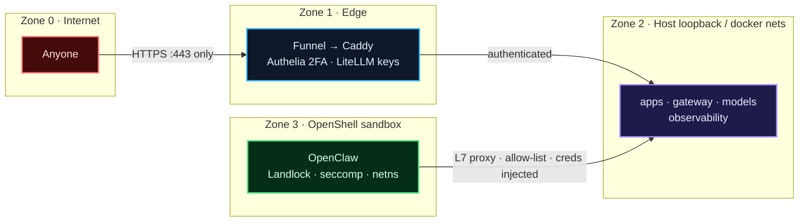

| Control | Setting |
|---|---|
| Public surface | **Only** Funnel `:443`. No `0.0.0.0` publishes. Host firewall default-deny inbound |
| Human auth | Authelia, **two_factor** on every UI path, `default_policy: deny`, regulation 3 tries / 30 min ban |
| Machine auth | LiteLLM virtual keys with model allow-lists, RPM caps, budgets |
| Header spoofing | `forward_auth copy_headers` overwrites; `/llm/v1` strips `Remote-*`; OpenClaw trusts only `127.0.0.1` |
| Sandbox | NemoClaw Balanced policy; egress only to LiteLLM `:4000`, OTLP `:4318`, Brave, GitHub |
| Docker socket | **rw:** `openshell-gateway` (required). **ro:** `docker-socket-proxy` (`POST=0`), `alloy`, `cadvisor`. Nothing public has socket access |
| Secrets | Docker secrets / `secrets/` `chmod 700`; never in `.env`, never in the sandbox |
| Optional hardening | Use Tailscale's Funnel request header to restrict `/admin`, `/grafana`, `/llm` UI to **tailnet-only** while `/openclaw` and `/llm/v1` stay public |
| Updates | Pin all image tags; Renovate/diun for update notices; never auto-pull `latest` |

---

## 17. Bring-up runbook

```mermaid
flowchart LR
    A["1 · Host<br/>Docker 28+ · NVIDIA toolkit<br/>Tailscale"] --> B["2 · Secrets<br/>+ Authelia users"]
    B --> C["3 · Weights<br/>/srv/models"]
    C --> D["4 · Core<br/>authelia · litellm · db<br/>model-runner · comfyui"]
    D --> E["5 · Observability<br/>alloy · prom · loki<br/>tempo · grafana"]
    E --> F["6 · OpenShell gateway<br/>container"]
    F --> G["7 · NemoClaw onboard<br/>reuse gateway · LiteLLM"]
    G --> H["8 · OpenClaw config<br/>basePath · trusted-proxy · otel"]
    H --> I["9 · Caddy + dashboard"]
    I --> J["10 · Funnel :443"]

    classDef s fill:#0b1220,stroke:#38bdf8,color:#e0f2fe,stroke-width:2px
    class A,B,C,D,E,F,G,H,I,J s
```

```bash
# 2 · secrets, .env, users.yml (then edit .env and set a password hash in authelia/users.yml)
cd /srv/ai-stack
bash scripts/init-secrets.sh

# 3 · weights
huggingface-cli download nvidia/Qwen3.6-35B-A3B-NVFP4 --cache-dir /srv/models/hf
huggingface-cli download Qwen/Qwen3-VL-30B-A3B-Instruct --cache-dir /srv/models/hf

# 4–5 · core + observability
docker compose up -d --build authelia litellm-db litellm model-runner comfyui comfy-mcp
docker compose up -d --build alloy prometheus loki tempo grafana node-exporter cadvisor gpu-exporter
bash scripts/create-litellm-keys.sh          # → secrets/litellm_keys.json

# 6 · OpenShell gateway
docker compose up -d openshell-gateway
openshell gateway add http://172.17.0.1:8080
openshell status

# 7 · NemoClaw (host CLI) — custom onboarding, reuse gateway
curl -fsSL https://www.nvidia.com/nemoclaw.sh | bash

# 8 · merge openclaw/openclaw.snippet.json5 into the sandbox's OpenClaw config

# 9 · edge + control
docker compose up -d --build caddy docker-socket-proxy admin-dashboard

# 10 · go public
sudo tailscale funnel --bg http://127.0.0.1:9080
```

---

## 18. Verification checklist

- [ ] `ss -tlnp` — no `0.0.0.0` listeners except `tailscaled`; bridge-IP listeners only on `172.17.0.1`
- [ ] From an **off-tailnet** device: `https://gb10…/` → Authelia login → 2FA → dashboard
- [ ] `/grafana`, `/comfy`, `/llm/ui`, `/openclaw` all redirect to `/auth` when logged out
- [ ] A `users`-group account can open `/openclaw` but gets `403` on `/admin`
- [ ] `curl /llm/v1/models` without key → `401`; with `laptop` key → model list
- [ ] Sending a forged `Remote-User` header to `/llm/v1` or a protected path has no effect
- [ ] First chat cold-starts the agent model; `up{job="vllm-agent"}` flips 0 → 1
- [ ] After `ttl`, `up{job="vllm-agent"}` → 0 and `MemAvailable` rises ~36 GB
- [ ] Agent `generate_image` works through the LiteLLM MCP gateway
- [ ] Tempo shows one trace spanning `openclaw.run` → `litellm` → `vllm`
- [ ] Grafana GB10 Host board shows GPU util/temp/power and the collector staleness panel is green
- [ ] Authelia bans an IP after 3 failed logins

---

## 19. Open items to verify

| Item | Why it matters | How to check |
|---|---|---|
| NemoClaw "reuse existing gateway" with a **containerised** OpenShell gateway | Core to the all-container design | `nemoclaw onboard` preflight; fall back to host-installed gateway if unsupported |
| Can OpenClaw config (`basePath`, `trusted-proxy`, plugins) be changed inside a NemoClaw sandbox and persist? | Required for `/openclaw` + SSO | NemoClaw docs on sandbox config / blueprint overrides |
| Does the sandbox reach `host.openshell.internal:4000` / `:4318` with your policy? | Inference + telemetry egress | `openshell` policy test from inside sandbox |
| ComfyUI frontend version that works under `/comfy/` | Sub-path breakage | Test UI, image previews, workflow save |
| LiteLLM `SERVER_ROOT_PATH` behaviour for UI + `/metrics` | Path routing + scraping | Hit `/llm/ui`, `/llm/metrics` |
| LiteLLM Prometheus & MCP-gateway licensing / availability in your version | Some features have been enterprise-gated historically | LiteLLM release notes |
| `Qwen3.6-35B-A3B` multimodal? | Drop the vision VLM (~24 GB) if yes | Model card |
| vLLM tool/reasoning parser names for Qwen3.6 | Wrong parser → empty `tool_calls` | NVIDIA Spark vLLM playbook |
| Exact arm64 tags: vLLM, PyTorch, LiteLLM, OpenShell gateway, cAdvisor | arm64 + CUDA 13 + sm_121 | NGC / GHCR manifests |
| llama-swap release asset name + per-model unload endpoint | Dockerfile + dashboard Down | llama-swap README / releases |
| Authelia cookie on a `*.ts.net` host | `ts.net` is a public suffix; cookie must be host-scoped | Login round-trip |
| Tailscale Funnel request header name for tailnet-only admin hardening | Optional hardening | Tailscale Funnel docs |

---

<sub>NVIDIA GB10 · DGX OS · NemoClaw · OpenShell · OpenClaw · vLLM · llama-swap · LiteLLM · ComfyUI · Caddy · Authelia · Tailscale Funnel · Grafana · Prometheus · Loki · Tempo · Alloy</sub>
